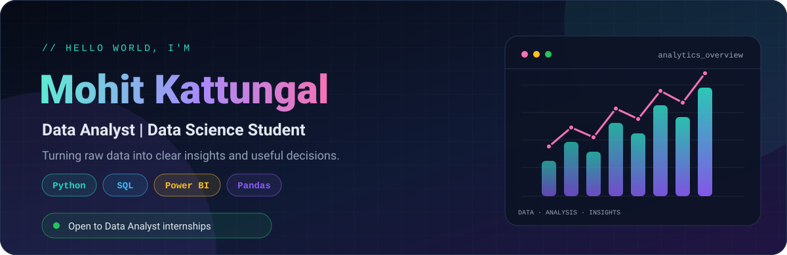
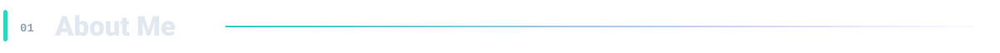
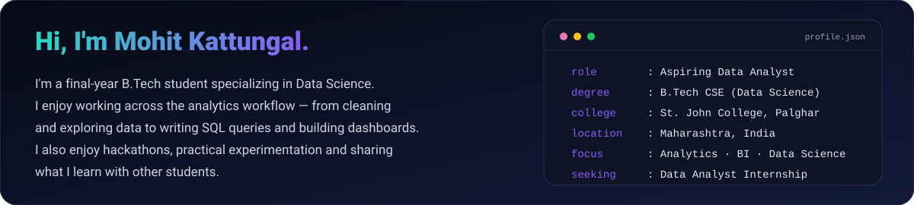
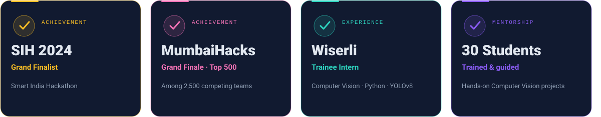
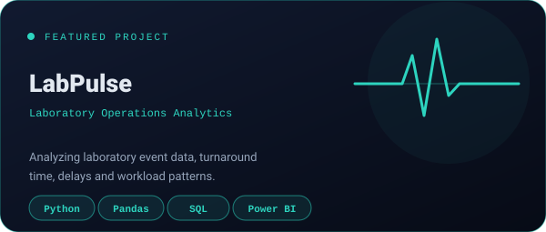
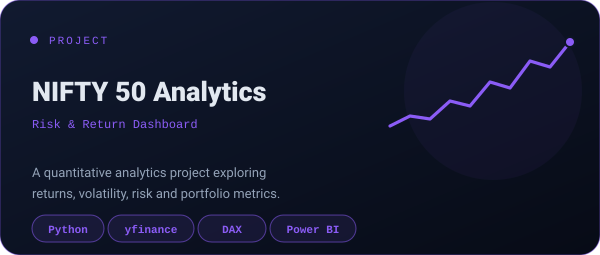
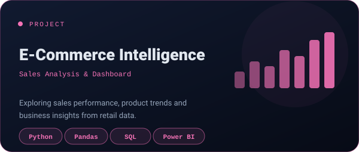
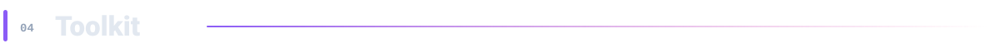
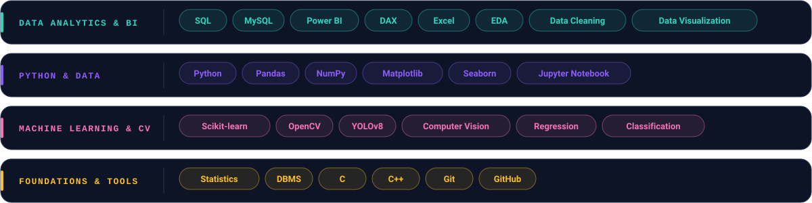

  

  

  

  

  

  

  

  

  

<table>
<tr><td width="50%" valign="top"></td><td width="50%" valign="top"></td></tr>
<tr><td width="50%" valign="top"></td><td width="50%"></td></tr>
</table>

  

  

  

  
  

  

  

  I'm always happy to connect, learn and collaborate on practical data projects.
   
  

  

<!--
PROFILE README NOTES
1. Edit generate_profile.py to update your name, links, skills and project URLs.
2. Run: python generate_profile.py
3. Commit both README.md and the assets/ folder to your profile repository.
4. GitHub statistics and streak cards are provided by external services and may
   occasionally be unavailable or rate-limited.
-->
